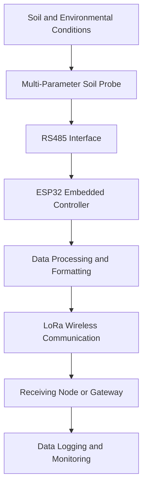

# 🌱 Multi-Sensor Soil Monitoring System Using IoT and LoRa Communication

**An embedded IoT-based soil monitoring system for precision agriculture, remote sensing, and data-driven farm management.**

[](https://www.espressif.com/en/products/socs/esp32)
[](https://lora-alliance.org/)
[](https://en.wikipedia.org/wiki/RS-485)
[](https://github.com/Abdulrahuf7775/FinalYearProject)

## 📌 Project Overview

The Multi-Sensor Soil Monitoring System is an embedded engineering project developed to support precision agriculture through the collection and wireless transmission of soil and environmental measurements.

Traditional soil monitoring methods can require manual sampling, repeated field visits, and laboratory analysis. These approaches may limit the frequency and spatial coverage of measurements. This project explores how embedded systems, sensor interfaces, wireless communication, and location-aware data collection can be integrated into a monitoring platform for agricultural applications.

The system uses an ESP32-based embedded platform, an RS485 sensor interface, and LoRa wireless communication to support remote monitoring across distributed locations. GPS functionality can associate measurements with geographical positions, enabling location-aware soil data collection where implemented.

The project brings together hardware integration, embedded firmware, sensor communication, wireless networking, power-system considerations, and engineering documentation in a single system.

## 🎯 Project Objectives

The primary objectives of this project are to:

1. Design and implement an embedded system for collecting soil measurements.
2. Integrate a multi-parameter soil probe through an appropriate RS485 interface.
3. Develop firmware for sensor communication, data acquisition, and processing.
4. Investigate LoRa communication for transmitting measurements over distances relevant to agricultural monitoring.
5. Incorporate GPS-based positioning to associate measurements with monitoring locations where supported.
6. Consider power consumption and energy requirements for field deployment.
7. Establish a foundation for remote monitoring, data logging, and future analytical applications.
8. Document the hardware design, software implementation, testing procedures, and engineering decisions.

## ✨ System Features

### 1. Multi-Parameter Soil Monitoring

The system is designed around a multi-parameter soil-sensing approach. The measurements available depend on the specific probe installed and its configuration.

Supported parameters should be documented according to the actual sensor specification and firmware implementation.

### 2. ESP32-Based Embedded Processing

The ESP32 serves as the embedded processing platform for coordinating sensor communication and the system's data-acquisition workflow.

Its capabilities support serial communication, peripheral interfacing, wireless connectivity, and integration with other embedded modules.

### 3. RS485 Sensor Communication

The system incorporates an RS485 interface for communicating with compatible soil probes. Where the probe uses Modbus RTU, the firmware must follow the sensor manufacturer's communication protocol, register map, and timing requirements.

### 4. LoRa Wireless Communication

LoRa is used as the intended long-range wireless communication technology for transmitting data between system components.

Its suitability for field deployment depends on the radio configuration, antenna, terrain, interference, regional frequency regulations, and the communication protocol implemented.

### 5. GPS-Based Location Information

GPS integration supports geographical tagging of measurements where implemented. Location information can help associate soil observations with specific monitoring points and support future mapping and spatial analysis.

### 6. Power-Aware Engineering

The project considers the electrical requirements of the embedded controller, sensors, communication modules, and other connected components.

Current consumption, peak operating demand, energy storage, and expected operating duration are important factors when evaluating suitability for remote agricultural deployment.

## 🏗️ System Architecture

The system can be understood as a sequence of sensing, processing, communication, and data-use stages.



*Note: This is a conceptual architecture. Adapt it to the final hardware configuration and the actual data-receiving and logging implementation.*

### System workflow

1. **Sensing:** The soil probe measures the parameters supported by the installed sensor.
2. **Communication:** The embedded controller communicates with the probe through the RS485 interface.
3. **Processing:** The firmware validates and formats the acquired measurements.
4. **Transmission:** The system prepares measurement data for transmission through the LoRa communication link.
5. **Reception:** A compatible receiver or gateway receives and processes transmitted data, where implemented.
6. **Monitoring:** The collected data can be recorded, analyzed, or presented through an appropriate monitoring interface.

## 🔩 Hardware Components

The following components are associated with the system design. Confirm the exact models, quantities, and electrical ratings against the final bill of materials.

| Component | Function |
|---|---|
| ESP32 development board | Embedded processing and peripheral coordination |
| Multi-parameter soil probe | Soil measurement acquisition |
| RS485 transceiver/interface | Serial communication with the soil probe |
| LoRa radio module | Long-range wireless data transmission |
| GPS receiver | Geographical positioning where implemented |
| Power supply or energy-storage system | Supplies the required operating power |
| Supporting electronic components | Regulation, wiring, protection, and interfacing as required |

The final hardware documentation should include the actual module names, datasheets, connection diagrams, pin assignments, voltage levels, and power requirements.

## 💻 Software and Firmware

The software component is responsible for coordinating the hardware and implementing the system's data-acquisition and communication logic.

Depending on the final implementation, the firmware may include:

- Hardware initialization and peripheral configuration.
- Sensor communication and measurement acquisition.
- Serial communication handling.
- Data validation and formatting.
- Wireless packet preparation and transmission.
- GPS data acquisition and association with measurements.
- Error handling and communication diagnostics.
- Power-management routines where implemented.

The source code and operating instructions are maintained in the relevant folders of this repository.

## 📁 Repository Structure

```text
FinalYearProject/
├── CV/
├── Operating_manual/
├── Project_report/
├── Source_Code/
├── project_banner/
├── research papers/
├── turnitin_report/
└── README.md
```

### Folder descriptions

| Directory | Description |
|---|---|
| `Source_Code/` | Project source code and implementation files |
| `Project_report/` | Final-year project report and supporting documentation |
| `Operating_manual/` | Operating instructions and system usage documentation |
| `project_banner/` | Project banner and presentation material |
| `research papers/` | Relevant research literature and supporting references |
| `CV/` | CV-related documents, if intentionally included |
| `turnitin_report/` | Similarity-report documentation, if approved for public distribution |

The descriptions above reflect the visible folder names. Refer to each folder's contents for the exact files and their purposes.

## 🚀 Getting Started

### Prerequisites

Before attempting to reproduce the hardware or firmware, prepare the following as applicable to the source code:

- A compatible ESP32 development board.
- The specified soil probe and its technical documentation.
- A compatible RS485 interface.
- The LoRa transmitter and receiver hardware.
- A compatible GPS module if required.
- A suitable USB cable and power supply.
- A computer with the required embedded development environment.
- The libraries and dependencies specified by the firmware.

### 1. Clone the repository

```bash
git clone https://github.com/Abdulrahuf7775/FinalYearProject.git
cd FinalYearProject
```

### 2. Review the documentation

Read the files in `Operating_manual/` and `Project_report/` before connecting the hardware.

Identify the correct firmware entry point, pin assignments, communication settings, sensor specifications, and required dependencies.

### 3. Configure the development environment

Install the development tools and libraries required by the actual source code. Select the appropriate ESP32 board configuration and communication settings.

### 4. Assemble the hardware

Follow the documented circuit diagram and wiring instructions. Verify supply voltages, signal levels, pin assignments, grounding, and interface compatibility before powering the system.

### 5. Configure the firmware

Update only the configuration values required by your hardware, such as serial parameters, sensor addresses, radio settings, or GPS configuration.

Do not publish private credentials or sensitive configuration values.

### 6. Build, upload, and test

Compile the firmware, upload it to the appropriate controller, and inspect serial diagnostics. Verify sensor readings and communication behavior before conducting field tests.

**Important:** Exact build commands, required libraries, and configuration instructions must be taken from the actual source files and operating manual.

## 🧪 Testing and Validation

A comprehensive evaluation of the system should consider the following tests, where applicable:

| Test | Purpose |
|---|---|
| Sensor communication | Verify communication between the controller and soil probe |
| Measurement validation | Compare reported values against the sensor specification or a suitable reference |
| Wireless communication | Verify successful packet transmission and reception |
| Communication range | Evaluate link performance under representative field conditions |
| GPS validation | Check positioning output against a suitable reference |
| Power consumption | Measure operating and peak current requirements |
| Endurance testing | Evaluate system stability during extended operation |
| Fault handling | Examine behavior during sensor disconnection or communication failure |

Experimental results should be reported with the test conditions, measurement methods, equipment, and limitations. No performance figures should be inferred without actual test evidence.

## 🌾 Applications

Potential applications include:

- Precision agriculture and field monitoring.
- Soil-data collection at multiple sampling locations.
- Agricultural research and experimental plots.
- Remote sensing in locations with limited network infrastructure.
- Location-aware soil-data logging and mapping.
- Research into low-power embedded monitoring systems.
- Future integration with agricultural dashboards and decision-support tools.

## ⚠️ Limitations and Considerations

The performance of an agricultural monitoring system depends on the quality of its sensors, calibration, installation, communications, and power supply.

Important considerations include:

- Sensor readings must be interpreted according to the probe's specifications and calibration.
- LoRa does not inherently provide internet access; a suitable gateway or receiving system is required for remote cloud monitoring.
- GPS accuracy depends on reception conditions and the selected receiver.
- Wireless range varies with the environment and radio configuration.
- Reliable long-term operation requires appropriate enclosure design, moisture protection, and electrical protection.
- Agricultural recommendations require suitable agronomic validation and should not be inferred from sensor measurements alone.

## 🔮 Future Improvements

Possible extensions to the system include:

- A web-based or mobile monitoring dashboard.
- Historical data storage and trend visualization.
- Geographical mapping of measurements.
- Automated alerts for configured soil conditions.
- Additional sensor nodes for broader field coverage.
- Improved low-power operation and energy optimization.
- Secure data transmission and device authentication.
- Data analytics and decision-support tools.
- Automated test suites and reproducible performance evaluations.

These are potential extensions, not claims that every feature is currently implemented.

## 📚 Documentation and References

Consult the project's operating manual, report, source code, and relevant sensor and communication-module datasheets for implementation details.

Additional references should be cited according to the referencing style used in the project report. Respect the copyright and redistribution terms of externally sourced research materials.

## 🤝 Contributions

Suggestions, bug reports, and technical discussions are welcome.

When proposing improvements:

1. Describe the problem or improvement clearly.
2. Include relevant hardware details and software versions.
3. Provide reproducible test steps where possible.
4. Avoid publishing passwords, API keys, private keys, or personal information.

## 📄 License

No open-source license has been specified here. Until a license is added, the repository should not be assumed to grant permission to reuse, modify, or redistribute its contents.

If you intend to release the code as open source, choose a suitable license after considering university requirements and the rights of any contributors.

## 👨‍💻 Author

**Abdulrahuf7775**

Final-year engineering project focused on embedded systems, sensor integration, wireless communication, and smart agriculture.

**Repository:** [FinalYearProject on GitHub](https://github.com/Abdulrahuf7775/FinalYearProject)

---

*This repository documents an engineering project in soil monitoring and embedded IoT systems. Hardware specifications, software dependencies, measured performance, and implemented capabilities should be verified against the source code and project documentation.*
